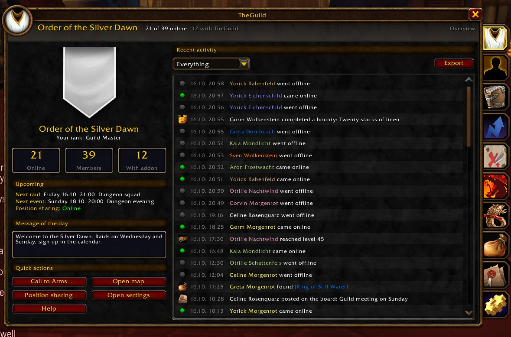
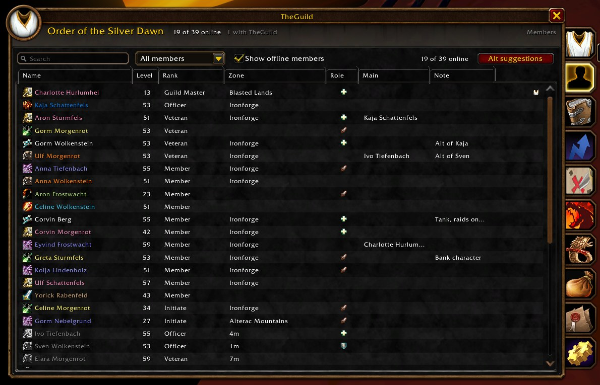
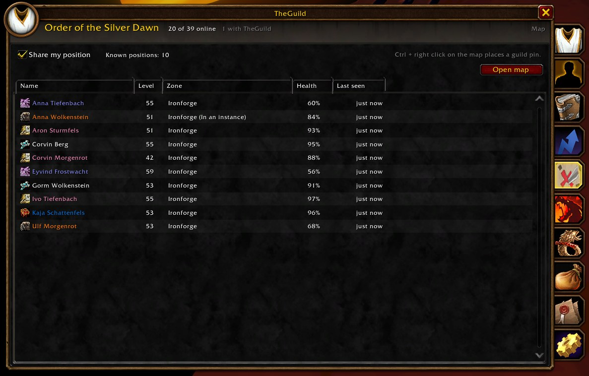
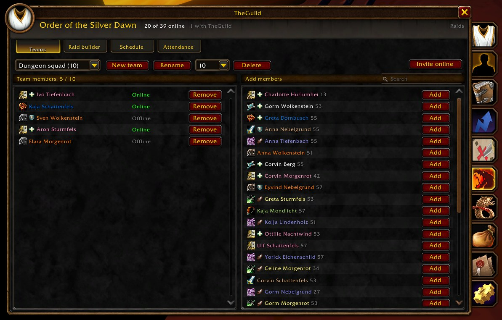
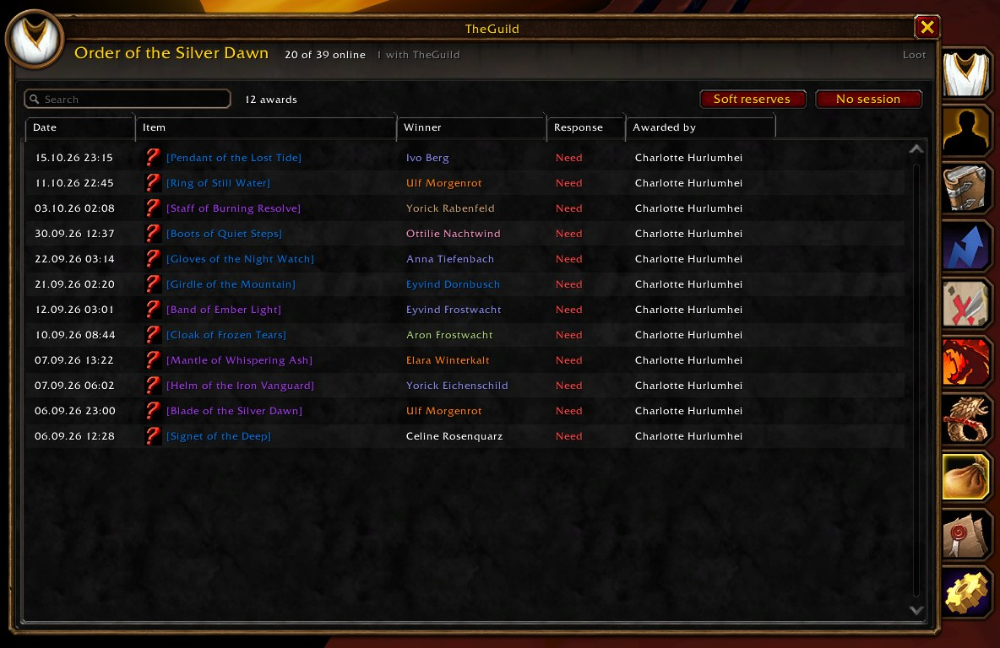
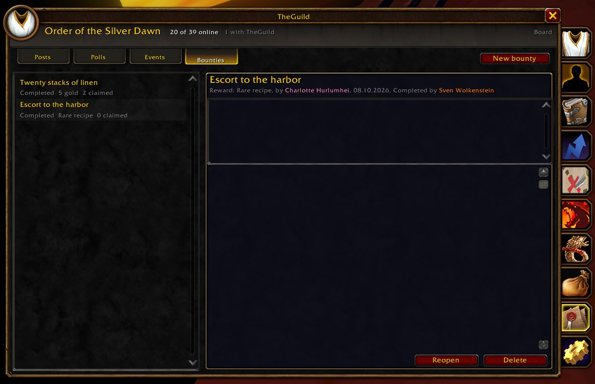
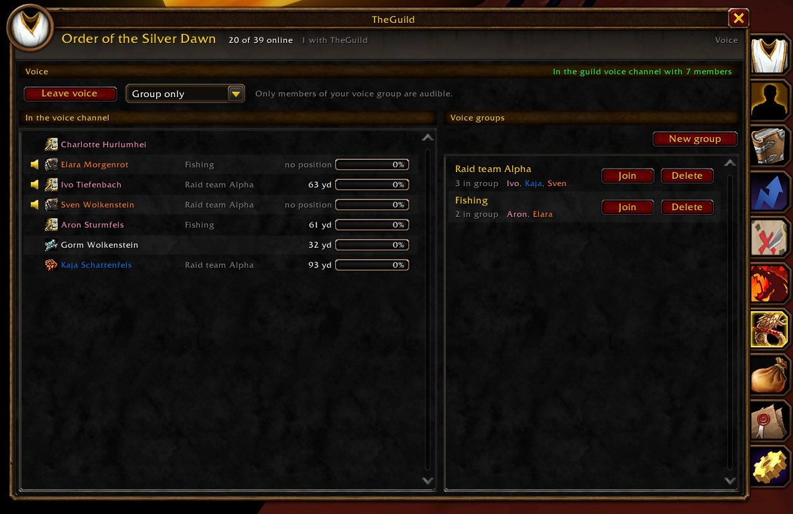
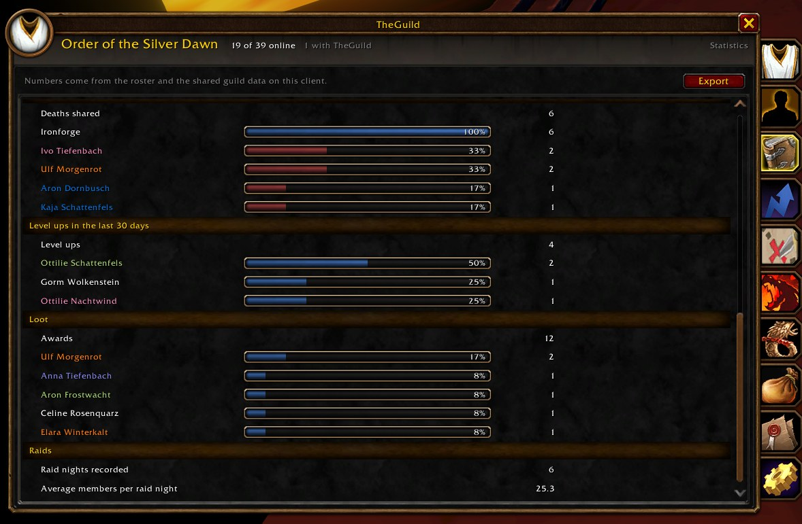
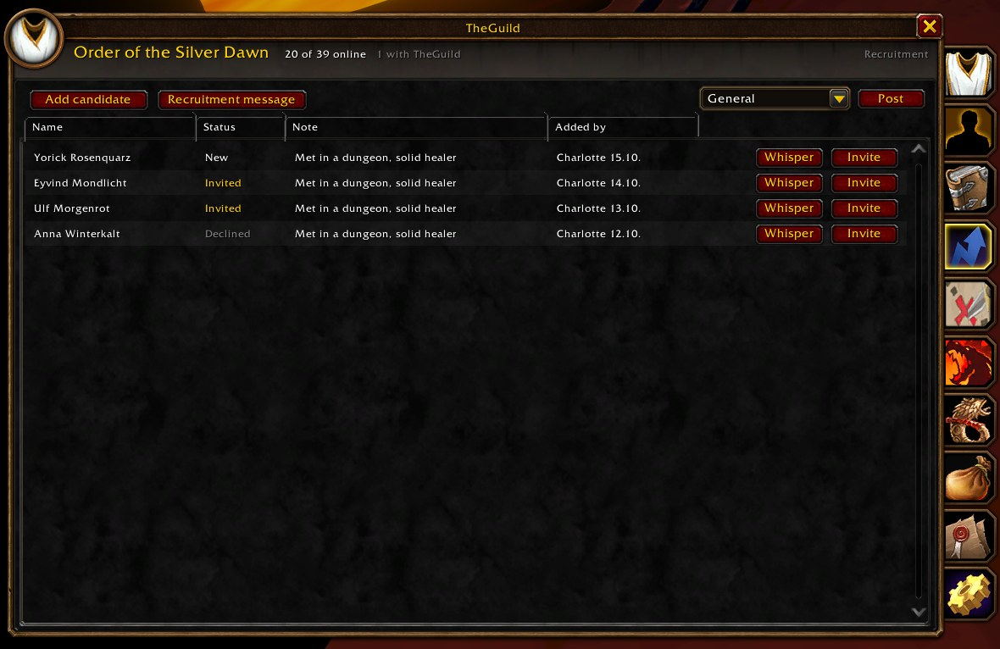
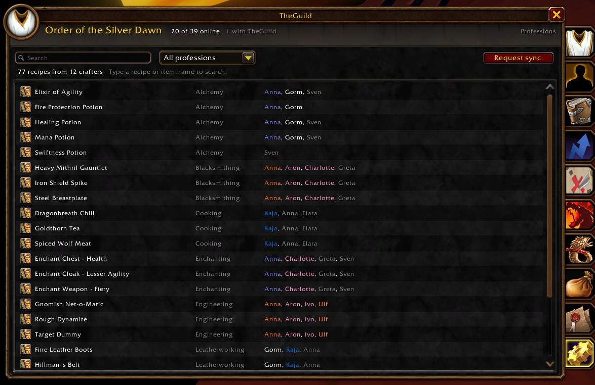

# TheGuild

**English** | [Deutsch](README.de.md)

The guild addon for World of Warcraft: Forever. One installation, everything in the Blizzard look, every feature its own module that can be switched off, no external server, nothing written into officer notes or the guild information.



## Installation

Download the release and copy the folders `TheGuild` and `TheGuild_*` into `World of Warcraft\_classic_beta_\Interface\AddOns`. Every module appears under TheGuild in the AddOn list and can be disabled there like any other addon.

For a git checkout, run `tools\link-modules.cmd` once. It creates junctions named after the modules so the client finds them inside the repository.

Open the window with `/tg`, the minimap button, the addon compartment or the TheGuild tab on the guild window.

## Modules

### Overview

Guild banner, member counts, who runs the addon, your rank, the next raid night, the next event, open bounties and the message of the day. The event log keeps logins, joins, leaves, renames, rank changes, level ups, deaths, calls to arms, raid nights, posts, polls, events and bounties with filters and text export.

### Members



Searchable and sortable roster with roles (tank, healer, damage) and main and alt links shared through the guild. Members set their own, officers set anyone's. Filters for officers, inactive members and missing roles. First seen, rank history, former members and renames travel through the guild. Officers get alt suggestions from public notes and can edit notes from the member menu. Right click opens whisper, invite, show on map, roles and alt links.

### Map



Guild members on the world map and the minimap with class icon or class colored dot, name, rank badge, health and tooltip. Positions are sent every few seconds while moving, never from inside an instance, optionally hidden while stealthed. Ctrl + right click on the world map places a guild pin for everyone, temporary or permanent. Deaths show up as skulls. Toggles live in the world map and minimap tracking menus.

### Raids



Named raid teams of 10, 20 or 40 kept in the guild store, one click invites for online team members with automatic raid conversion. The raid builder plans the subgroups with role counts per group, fills tanks and healers evenly and moves the live raid into the planned groups with one click. Raid days per team show the upcoming nights and export as guild sign up events into the Blizzard calendar. Officers in a raid record attendance automatically, the attendance table shows percentages and the last nights.

### Loot



Loot sessions for the group leader or an assistant. Items come from the loot window or `/tg loot <link>`, everyone answers with Need, Greed, Offspec or Pass, officers vote, the owner awards. Awards are announced in group chat and kept in a shared history. Items your class cannot use are passed automatically. Soft reserves from softres.it can be pasted, reserved players are marked and the list travels with the session. The trade helper remembers awarded items in your bags, offers a button above the trade window that places them for the right player and clears the entry once the item changed hands. Rare or better finds are reported to the guild with their bind type.

### Board



Posts, polls, events and bounties kept in the guild store. Everyone posts, officers pin and delete, posts fade after a configurable number of days. Officers create polls with up to eight options, members vote once and can change their vote until the poll closes. Events collect sign ups (yes, maybe, no) and export to the Blizzard calendar. Bounties are tasks with a reward: anyone posts one, members claim it, the author or an officer awards it.

### Voice



Proximity voice on the Blizzard guild voice channel. Everyone joins the same channel, the addon turns each member up or down on your client by distance: full volume up to 30 yards, silent beyond 90 (both configurable). Positions come from the Map module. Voice groups work like the groups of the Minecraft proximity mods: create one, others join, group members stay at full volume wherever they are. Three modes: group and proximity, where you still hear and talk to anyone who walks past you without your group hearing them; proximity only, where you keep hearing your group but your group hears you only when you stand close, handy when you run into somebody and do not want to talk over the group; and group only, which silences everybody outside your group. Joining a party or raid turns the guild members in it into a voice group automatically, so voice stays on the guild channel and Blizzard party voice is never needed. The group list has a search for group names and players. The tab shows who is in the channel, who speaks, distance and current volume. A small movable microphone button on the screen shows whether you are muted or deafened and how many members you can hear right now, and below it a compact list of who is in the channel with class icon, speaker icon while they talk and a mute marker. Left click mutes, right click opens a menu with mode, join, leave and the list toggle. The game client's own speaking toasts above the chat are hidden while the module runs, a setting brings them back. The row of a member who is talking gets a green frame, the way Discord highlights speakers.

### Statistics



Member counts and activity, class and level distribution, lifetime deaths by zone and member, lifetime level ups, loot awards and raid attendance with small rankings that each character can opt out of. Every character counts its own deaths and level ups and shares the totals, so the numbers survive logouts and grow for the life of the guild. Everything exports as text.

### Recruitment



Officers keep a shared candidate list with notes and status. Candidates can be added from the unit menu of any player. Whisper and guild invite are one click. Candidates who join are marked and get a welcome whisper from the officer who invited them. A recruitment message can be posted into a chosen chat channel.

### Professions



Records your recipes when a profession window opens, shares them with the guild and shows crafters in item tooltips and in a searchable recipe directory.

### Call to Arms and Messages

`/tg cta`, a key binding or the overview button sends your location to the guild. Receivers get a raid warning, a sound and a popup with a waypoint button. The Messages module welcomes new members, optionally greets logins and congratulates milestone levels, and hides chat from muted players.

## Blizzard integration

The window is built from the client's own templates: a portrait frame with side tabs for the modules, column headers in the who list style, inset lists, tab strips inside the panels and the guild banner with the tabard.

- Tab on the guild window that opens TheGuild.
- Entries in the context menus of players, targets, focus and friends. The guild roster and group menus stay untouched, because Blizzard runs protected actions like removing a member from there and any addon addition would block them.
- Entries in the world map and minimap tracking menus.
- Role, main and addon version in unit tooltips.
- Settings under Options > AddOns > TheGuild, profile export and import as text.
- Key bindings for the window, call to arms, position sharing and the microphone, also set from the addon options.
- Keyboard: Escape closes, Ctrl + Tab switches tabs, Ctrl + F jumps to the search field. Gamepad shoulder buttons switch tabs.
- A guided tour in the client's own help tip style the first time you open the window: it walks through every tab and explains the main controls, the microphone button gets its own hints when it first appears. The tour can be switched off or started again in the settings.

## Commands

```
/tg              toggle the window
/tg config       open the settings
/tg share        toggle position sharing
/tg cta [text]   send a call to arms
/tg loot <link>  start a loot session, /tg loot end, /tg loot sr
/tg voice        voice tab, /tg voice join, /tg voice mute, /tg voice group <name>, /tg voice hud
/tg mute <name>  mute or unmute a player
/tg export       settings as text, /tg import pastes them
/tg demo         fill everything with made up data for a presentation
/tg memory       memory of the addon and size of the shared data
/tg keys         signing key status, /tg keys bench measures signing speed
/tg sync         request a data sync
/tg version      versions of guild members running the addon
/tg help         list of commands
```

## How the data travels

Everything the guild shares travels over the guild addon channel between members who run the addon. Shared data uses a revision per entry, the highest revision wins, every client checks the author's rank before accepting a change, and clients compare their data on login and every 20 minutes. Positions go out only while moving, sync answers are staggered and limited to three responders, bulk data is compressed and chunked.

Trust rules: every entry is signed by its author with a key pair that each character generates on first login (Ed25519 style, implemented in Lua, a few milliseconds per signature). An entry is accepted directly from its author, whose name the client guarantees, or from anyone else when the signature matches a trusted key of the author. Keys become trusted when a member is seen directly, or through a certificate that an officer or the guild master signs automatically for keys they have seen. The guild master's key is trusted only from direct contact, officer keys only from direct contact or a guild master certificate, so no officer can vouch for a key above their rank. A relayer whose entries fail verification three times is ignored for ten minutes, a member who sends more than 256 KB of decompressed data per minute is ignored for five minutes, heartbeats, profession requests and finds are rate limited per sender. Entries relayed by an officer show up at once and are verified in the background, entries relayed by members wait for the verification, guild master settings always wait. Verification runs in small slices per frame, so it never stalls the game. Revisions must be whole numbers without huge jumps, unknown data types are dropped, and texts from other players lose texture and link escapes. Every data type has a shape that incoming entries must match (a post needs a text title, a vote is a number between 1 and 8, a certificate carries a 64 character key), so a malformed entry cannot break the window of other members. Every entry is capped at 8 KB, every member at 300 entries per data type (officers 2000), and short lived data types have a retention period after which entries are dropped on every client: posts and polls 180 days, events and sign ups 60 days, bounties 90 days, death markers 14 days, voice groups 30 days. Statistics are never deleted: loot history, raid attendance, former members and the lifetime counters each member keeps for deaths and level ups stay forever. Deleted entries leave a marker for 45 days so late clients cannot revive them, then the marker goes too. A sync request is answered at most once per five minutes per requester. Guilds you have not visited for 90 days are removed from the saved data. Loot sessions are accepted only from the group leader or an assistant on the party or raid channel, items go into the trade window only after a click, and the trade partner is matched by GUID. Calls to arms are limited to one per sender per minute. Bulk messages are capped at 40 chunks with two open transfers per sender.

- `TheGuildDB` (account wide): settings, guild data per guild, event log.
- `TheGuildCharDB` (per character): position sharing, cooldowns.

| Tag | Content |
| --- | --- |
| HI | version and guid, presence heartbeat |
| P | map, position, health and flags |
| ST / SB | one store change, batch of store items |
| SQ | sync request with revision digest |
| CTA | call to arms |
| LF | item find |
| LS / LR / LV / LA / LE | loot session messages, sent to the raid or party |
| PS / PQ | profession snapshot and request |

## Development

- Clone the repository into `Interface\AddOns\TheGuild` and run `tools\link-modules.cmd` once. It creates junctions `AddOns\TheGuild_<Module>` pointing at `TheGuild\Modules\<Module>`, so the client loads every module straight from the checkout.
- `TheGuild.toc` is the core, every folder under `Modules` is its own addon with `## Dependencies: TheGuild` and `## Group: TheGuild`. A module registers itself with `TG:NewModule`, registers events and comm handlers through its module methods so disabling it removes everything, and adds its window tab with `TG.Window:RegisterTab`.
- All window pieces come from `Core/UI.lua` and use only templates the Forever client ships. Column headers, inset lists, tab strips, section headers, cards, stat tiles, bars and the guild banner are helpers there.
- Shared data goes through `TG.Store` with a policy per namespace: `any`, `self`, `officer`, `gm` or `own`. Every value from chat, units or the roster is checked with `TG.usable` before use because the client hands out secret values.
- Text lives in `Locales/enUS.lua` with a German translation in `Locales/deDE.lua`. Every new string needs both.
- The code carries no comments on purpose. This file and `ROADMAP.md` hold the explanations.
- `/tg demo` fills every module with made up data without a guild, `/tg memory` prints memory and store sizes, `/tg voice status` prints the voice chat state.

## Releases

Every push to `main` runs the release workflow in `.github/workflows/release.yml`, except pushes that only touch the READMEs, the roadmap or the screenshots. The workflow checks that every file listed in a TOC exists, raises the patch version in all TOCs, commits that as `release vX.Y.Z` with a tag, builds the zip in the release layout (`TheGuild` plus one `TheGuild_<Module>` folder per module, the layout `.pkgmeta` describes), publishes a GitHub release with the zip and uploads the file to CurseForge. The CurseForge game version is derived from `## Interface` and looked up in the Forever version type, so a client patch only needs the TOCs bumped.

Minor and major versions are raised by hand in all TOCs before the push, the workflow only counts the last digit. The workflow can also be started by hand from the Actions tab with a release type of release, beta or alpha. It needs the repository variable `CF_PROJECT_ID` and the secret `CF_API_TOKEN`.

## License

TheGuild uses its own license, see `LICENSE`. You may use it freely, read and fork the source, change it for yourself or your guild and send contributions. Publishing the addon or a modified version somewhere else is not allowed while the project is maintained, meaning a release within the last twelve months, or within one month after a game update left the addon completely non functional. After that, modified versions may be published under a different name with a link back here. Selling the addon or a fork, or putting it behind a paywall, is never allowed. The bundled libraries keep their own licenses.

## Libraries

LibStub, CallbackHandler-1.0, ChatThrottleLib, LibSerialize, LibDeflate, LibDataBroker-1.1, LibDBIcon-1.0, HereBeDragons-2.0. Each ships with its own license.
